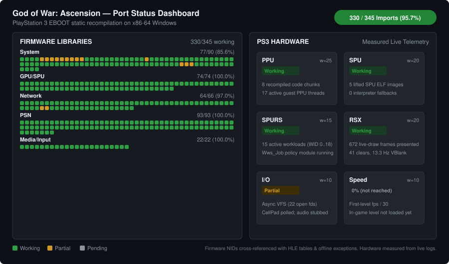

# God of War: Ascension (PS3) Native PC Port

An x86-64 static recompilation port of God of War: Ascension for Windows. The project translates the original PlayStation 3 binary and embedded SPU workloads into native C and C++ using the [ps3recomp](https://github.com/sp00nznet/ps3recomp) toolchain.

## How it works

Traditional emulators interpret or JIT-compile machine code at runtime. This port uses static recompilation, converting the game ahead of time so it compiles into a normal 64-bit Windows executable:

The game binary (`EBOOT.ELF`) is split and translated into eight C++ translation units (`src/gen/ppu_recomp_*.cpp`). Syscalls and OS library calls resolve through high-level emulation (HLE) shims in `src/compat/`.

Embedded SPU binaries, including Sony's WWS Job System Policy Module and Edge Geometry code, are lifted into C and execute across host worker threads.

The RSX (NV4097) graphics pipeline renders through a Direct3D 12 backend. It reads command packets directly from the GCM ring buffer, handles descriptor binding and pipeline states, and presents through a standard DXGI swapchain.

Game data streams through an asynchronous Virtual File System (VFS) mapped to local disk instead of the PS3 Blu-ray drive.

The Win32 window message loop runs on its own thread, isolated from the 60 Hz RSX presentation ticker so the window stays responsive even during long file loads.

Controller input maps through XInput with keyboard fallbacks.

## Status

<picture>
  <source media="(prefers-color-scheme: dark)" srcset="docs/status-dark.svg">
  <source media="(prefers-color-scheme: light)" srcset="docs/status-light.svg">
  
</picture>

[View detailed tables and classification methodology](docs/status.md)

Firmware coverage measures imported PS3 OS functions against working high-level emulation handlers and offline-safe stubs. Hardware metrics are parsed directly from live runtime execution logs. Speed remains at 0% (not reached) until in-game level gameplay begins.

Regenerate the dashboard and status documents with:

```bash
python tools/gen_status.py
```

## Current status

| Component | Status | Details |
|---|---|---|
| PPU code lifting | Working | 19,570 functions across 8 translation units; 17 concurrent guest threads |
| SPU / SPURS workloads | Working | 5 lifted SPU images; WWS job policy module running with zero interpreter fallbacks |
| VFS streaming | Working | Asynchronous disk streaming reaches ~23 MB/s across 22 archive descriptors |
| RSX presentation | Working | Direct3D 12 swapchain presents live-draw frames with active FIFO command processing |
| RSX FIFO processing | Working | GCM offset tables mapped, JUMP/CALL validation in place |
| FIOS synchronization | Working | Real Win32 event wait queues with FIFO condition variable ordering |
| Audio engine | Partial | CellAudio initialized with WASAPI output backend and stubs |
| In-game gameplay | Not reached | Boot progression advances through intro loops and title presentation |

Technical notes and bring-up logs live in [docs/](file:///C:/IfItWorksItWorks/Project/gowassension/docs/) and [.planning/](file:///C:/IfItWorksItWorks/Project/gowassension/.planning/).

## Requirements

- Windows 10 or 11 (64-bit)
- Visual Studio 2022 (MSVC v143 or `clang-cl`) with C++20 support
- CMake 3.24 or newer
- Ninja
- Python 3.10 or newer
- A legally dumped copy of God of War: Ascension (PS3)

## Building from source

### 1. Clone with submodules

```bash
git clone --recursive https://github.com/YJuDeAd/gow-ascension-pc-port
cd gowassension
```

If you cloned without `--recursive`, initialize them now:

```bash
git submodule update --init --recursive
```

### 2. Add your game files

Copy your decrypted game files into the `vfs` folder:

```text
vfs/PS3_GAME/USRDIR/EBOOT.ELF
vfs/PS3_GAME/USRDIR/EBOOT.BIN
vfs/PS3_GAME/PARAM.SFO
```

Game assets and executables are not included in this repository.

### 3. Apply upstream runtime patches

Apply the required compatibility fixes to the local `ps3recomp` tree:

```powershell
git -C ps3recomp apply ../patches/ps3recomp_current.patch
```

### 4. Compile

Build the `ps3recomp` runtime library first, then build the main executable:

```powershell
# Build ps3recomp runtime
cmake -S ps3recomp -B ps3recomp/build -G Ninja -DCMAKE_BUILD_TYPE=Release
cmake --build ps3recomp/build

# Build the game executable
cmake -S . -B build -G Ninja -DCMAKE_BUILD_TYPE=Release
cmake --build build
```

The output binary is written to `build/gow_ascension.exe`.

## Running

Launch the port with the PowerShell runner:

```powershell
# Run with Direct3D 12 graphics enabled
.\tools\run_port.ps1 -LiveDraw

# Interactive mode (no automatic timeout)
.\tools\run_port.ps1 -Interactive

# Custom resolution
.\tools\run_port.ps1 -LiveDraw -Width 1920 -Height 1080 -TimeoutSeconds 30
```

Default settings can also be edited in `config.toml`:

```toml
[video]
width = 1280
height = 720
vsync = "on"
live_draw = true

[input]
auto_pad_start = false
deadzone = 7849
```

## Repository layout

```text
gowassension/
├── .planning/       Roadmaps, phase specs, and verification records
├── analysis/        Function maps, symbol tables, and SPU/PPU triage data
├── docs/            Architecture notes and bring-up progress logs
├── patches/         Patches for the upstream ps3recomp runtime
├── ps3recomp/       Upstream runtime and lifter tools (submodule)
├── src/
│   ├── main.cpp           Window setup, thread orchestration, main loop
│   ├── boot_main.cpp      Alternative boot harness
│   ├── hle_extra.cpp      Additional HLE handlers
│   ├── compat/            Game-specific HLE overrides (GCM, FIOS, SPURS, sync)
│   └── gen/               Machine-generated PPU and SPU code
├── tools/           Automation scripts for lifting, testing, and triage
├── twistedmetal/    Reference PS3 port implementation (submodule)
├── vfs/             Virtual file system root for game data
└── CMakeLists.txt   Root build configuration
```

## Contributing

Pull requests and issues are welcome. A few rules keep the codebase maintainable:

- Keep `ps3recomp/` and `twistedmetal/` as read-only upstream references. All game-specific overrides, patches, and shims belong in `src/compat/` or `patches/`.
- Never hand-edit files in `src/gen/`. Those are generated by the lifters. If a lifted function needs different behavior, change the lifter script or override the symbol in `src/compat/`.
- Automation scripts in `tools/` should be cross-platform Python (`.py`) or PowerShell (`.ps1`).
- Compile generated code in Release mode (`-O2` / `/O2`) without full debug PDBs to avoid consuming tens of gigabytes of disk space.

### Where to help right now

- Implementing real Win32 condition variables in `src/compat/ascension_hle.cpp` for `sys_lwcond`. The existing stub drops signals, leaving media worker threads stuck.
- Translating NV4097 microcode into HLSL to draw the first 3D passes once scenes finish loading.
- Optimizing SPU-assisted skinning and vertex buffer decompression in Edge Geometry.
- Building a real audio output backend for CellAudio callbacks.

## Acknowledgments

Portions of runtime research and compatibility patches are adapted from [gow-ascension-pc](https://github.com/arnaldo-lima/gow-ascension-pc) by Arnaldo Lima & contributors under the MIT License (see [THIRD_PARTY_NOTICES.md](file:///C:/IfItWorksItWorks/Project/gowassension/THIRD_PARTY_NOTICES.md)).

## Legal

This is an independent preservation and research project. It is not affiliated with or endorsed by Sony Interactive Entertainment or Santa Monica Studio.

This repository does not contain any copyrighted game assets, proprietary Sony code, encryption keys, or disc images. You must provide your own legally obtained copy of the game.
