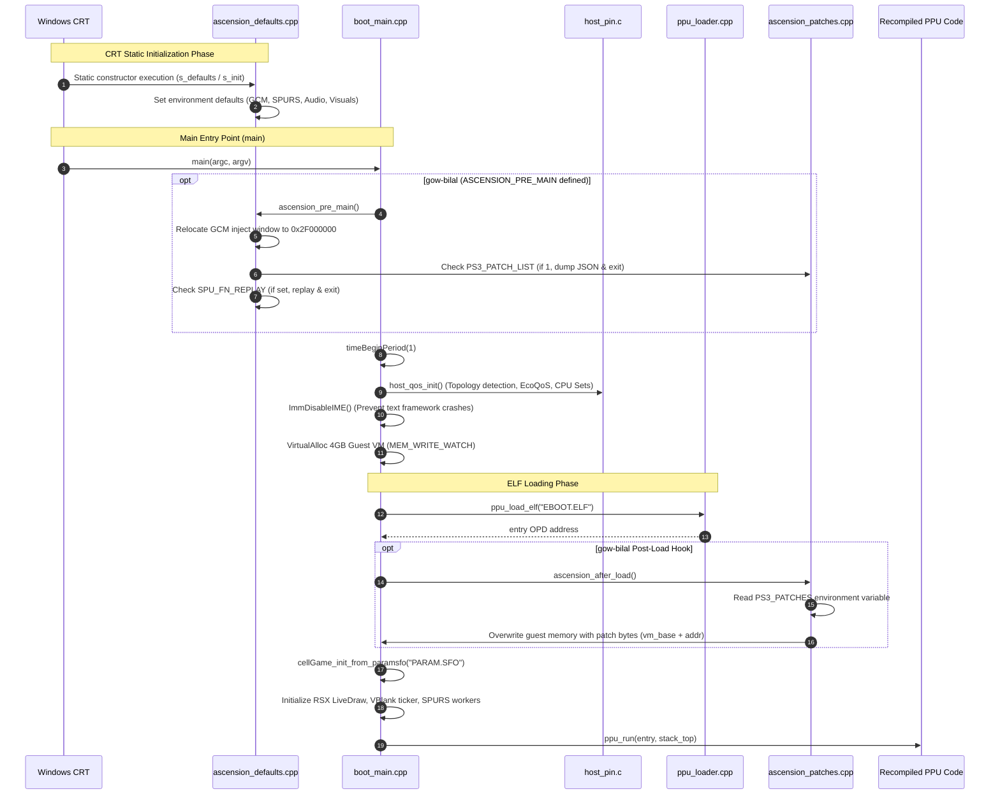

# Comprehensive Host Architecture & Compatibility Overrides Comparison: gow-bilal vs. gowassension

**Report Date:** 2026-11-15  
**Author:** Sub-agent `bilal-host-diff`  
**Target Reference Repositories:**  
- Reference Target: `C:\IfItWorksItWorks\Project\gow-bilal\` (Read-Only)  
- Local Target: `C:\IfItWorksItWorks\Project\gowassension\`  
**Target Output Path:** `C:\IfItWorksItWorks\Project\gowassension\docs\reports\bilal-host-diff.md`

---

## 1. Executive Summary & Architectural Overview

This report provides an exhaustive, line-by-line comparative analysis of the host architecture, runtime environment defaults, CPU scheduling, thread placement, patch infrastructure, VRAM memory safety, and hardware workarounds between:
1. **The Reference Port (`gow-bilal`)**: Represents a mature, release-ready PC port of *God of War: Ascension* (v0.1.28) featuring automated topology-aware thread placement, dynamic RPCS3 patch injection at boot, advanced VRAM bounds checking and compaction recovery, and CPU-specific scheduler workarounds.
2. **Our Local Port (`gowassension`)**: Represents our current implementation baseline utilizing upstream `ps3recomp` infrastructure, static recompilation patches, hardcoded fallback defaults, and manual PowerShell CLI test harnesses.

### Primary Architectural Differences at a Glance

| Architectural Subsystem | Reference Port (`gow-bilal`) | Local Port (`gowassension`) |
| :--- | :--- | :--- |
| **Boot Hook Harness** | Compile-time define `ASCENSION_PRE_MAIN` in CMake; explicit pre-boot (`ascension_pre_main`) and post-ELF-load (`ascension_after_load`) C hooks inside `boot_main.cpp`. | Static global C++ constructor (`AscensionDefaultsInit s_init`) running before CRT `main()`; no post-load hook. |
| **Thread Placement** | Advanced 2,128-line topology engine (`ps3kit/runtime/platform/host_pin.c`) with Windows CPU Set API (`SetThreadSelectedCpuSets`), SMT sibling awareness, L3 cache clustering, and dedicated layouts for 6-core, 8-core, dual-CCD X3D, and Intel hybrid/E-core CPUs. | Naive logical CPU check (`logical_cpus() <= 8`) setting `SPURS_NSPUS=5` and hard affinity mask pinning only the PPU main thread to Core 0 (`SetThreadAffinityMask(..., 1 << 0)`). |
| **Process & Thread Priorities** | Elevated process class (`ABOVE_NORMAL_PRIORITY_CLASS`), RSX walker thread at `THREAD_PRIORITY_HIGHEST`, audio mixer at `THREAD_PRIORITY_TIME_CRITICAL`, SPU sound job (wid 8) boosted, and MMCSS (`Games`/`Audio`) integration. | Default `NORMAL_PRIORITY_CLASS`, all threads run at default OS priority; no MMCSS or audio thread priority boosts. |
| **Patch Management** | Dynamic runtime patch table (`ascension_patches.cpp` + `ascension_patch_table.inc`) with PPU patch-sites lifting (`ppu_lifter.py --patch-sites`); patches applied in-memory at boot without recompiling. | Static PPU recompilation; no dynamic guest memory patch table; upstream git series patches applied directly to `ps3recomp` source code. |
| **VRAM Safety & Memory Guards** | Dedicated VRAM manager interceptor (`ascension_vram_guard.cpp`) catching `CopyLocalMemory`/`MoveLocalMemory` out-of-bounds, negative mipmap cuts, and repairing corrupted streamed texture descriptors. | Raw lifted PPU code; traps (`tw 31,r1,r1`) emitted as comments, allowing negative cuts to cause unbounded 4 GB copy loops. |
| **GCM / RSX Synchronization** | `GCM_PARK_WAIT_MS=60000` (60s wait preventing permanent freeze) and `GCM_REPORT_SPU_HOLD_MS=2000` (accommodating SPU MLAA and slow CPU cores). | `GCM_PARK_WAIT_MS=2000` (2s wait susceptible to timeout freezes) and `GCM_REPORT_SPU_HOLD_MS=50` (50ms wait causing immediate hang if SPU MLAA is enabled). |

---

## 2. Environment Variables & Runtime Defaults Comparison

### 2.1 Implementation Structure

- **`gow-bilal`**:
  - Implemented in `C:\IfItWorksItWorks\Project\gow-bilal\ascension\host\ascension_defaults.cpp` (450 lines).
  - Uses a static struct constructor `struct AscensionDefaults s_defaults` (`ascension_defaults.cpp:143-418`) to populate Win32 environment variables via `SetEnvironmentVariableA` and CRT `_putenv_s` (`ascension_defaults.cpp:131-137`).
  - Calls `ascension_patch_on("Unlock FPS")` at initialization (`ascension_defaults.cpp:151`) to dynamically couple frame limiter (`PS3_FPS_LIMIT`) and overlay refresh rate (`LD_PERF_OVERLAY_FPS`).
  - Implements `ascension_pre_main()` (`ascension_defaults.cpp:436-450`) to relocate GCM inject window to `0x2F000000` (`ascension_defaults.cpp:444-445`), query patch listing via `ascension_patch_list_main()` (`ascension_defaults.cpp:447`), and launch SPU function replay via `spu_fnrec_replay_main()` (`ascension_defaults.cpp:449`).
- **`gowassension`**:
  - Implemented in `C:\IfItWorksItWorks\Project\gowassension\src\compat\ascension_defaults.cpp` (384 lines).
  - Uses static struct constructor `struct AscensionDefaultsInit s_init` (`ascension_defaults.cpp:376-380`) calling `ascension_apply_defaults()` (`ascension_defaults.cpp:212-373`).
  - Contains extensive FIOS zero-filled cache detection and sanitization logic (`ascension_defaults.cpp:271-307`).
  - Implements deterministic SHA-1 verification logging of all applied defaults (`ascension_defaults.cpp:340-370`).
  - Enforces hardcoded ISO virtual drive mount check for `E:/PS3_GAME/USRDIR/GAME.PSARC` (`ascension_defaults.cpp:322-337`).

### 2.2 Detailed Variable-by-Variable Comparison

The following table provides an exhaustive comparison of all environment variables configured across both codebases:

| Variable Name | `gow-bilal` Value & Citation | `gowassension` Value & Citation | Difference Analysis & Technical Impact |
| :--- | :--- | :--- | :--- |
| `PS3_FPS_LIMIT` | `unlocked ? "60" : "30"`<br>([ascension_defaults.cpp:152](file:///C:/IfItWorksItWorks/Project/gow-bilal/ascension/host/ascension_defaults.cpp#L152)) | *Not Set* | `gow-bilal` dynamically adjusts the frame cap to 60 if the "Unlock FPS" patch is active, otherwise locks to 30. `gowassension` leaves it unset, defaulting to runtime unconstrained/vsync behavior. |
| `LD_PERF_OVERLAY_FPS` | `unlocked ? "60" : "30"`<br>([ascension_defaults.cpp:153](file:///C:/IfItWorksItWorks/Project/gow-bilal/ascension/host/ascension_defaults.cpp#L153)) | *Not Set* | Matches overlay framerate target to game clock limit. |
| `LD_PERF_OVERLAY_REALTIME` | `"1"` (if unlocked)<br>([ascension_defaults.cpp:154](file:///C:/IfItWorksItWorks/Project/gow-bilal/ascension/host/ascension_defaults.cpp#L154)) | *Not Set* | Enables real-time wall-clock pacing calculations in overlay when running unlocked. |
| `PS3_SKIP_MOVIES` | `"1"`<br>([ascension_defaults.cpp:157](file:///C:/IfItWorksItWorks/Project/gow-bilal/ascension/host/ascension_defaults.cpp#L157)) | *Not Set* | Skips intro videos automatically via internal CROSS button injection during VDEC decode. |
| `GCM_FIFO_CIRCLE_PASSES` | `"0"`<br>([ascension_defaults.cpp:161](file:///C:/IfItWorksItWorks/Project/gow-bilal/ascension/host/ascension_defaults.cpp#L161)) | *Not Set* | Disables the FIFO walker's circling heuristic which mistakenly identified heavy Ascension combat loops as stuck loops, skipped fences, and crashed. |
| `PS3_EDGE_ZLIB_HLE` | `"1"`<br>([ascension_defaults.cpp:162](file:///C:/IfItWorksItWorks/Project/gow-bilal/ascension/host/ascension_defaults.cpp#L162)) | `"1"`<br>([ascension_defaults.cpp:220](file:///C:/IfItWorksItWorks/Project/gowassension/src/compat/ascension_defaults.cpp#L220)) | Identical: Routes Edge Zlib decompression to host CPU threads. |
| `RSX_LIVE_DRAW` | `"1"`<br>([ascension_defaults.cpp:163](file:///C:/IfItWorksItWorks/Project/gow-bilal/ascension/host/ascension_defaults.cpp#L163)) | `"1"`<br>([ascension_defaults.cpp:221](file:///C:/IfItWorksItWorks/Project/gowassension/src/compat/ascension_defaults.cpp#L221)) | Identical: Enables NV4097 LiveDraw Direct3D 12 rendering pipeline. |
| `LD_PSO_SAME` | `"1"`<br>([ascension_defaults.cpp:176](file:///C:/IfItWorksItWorks/Project/gow-bilal/ascension/host/ascension_defaults.cpp#L176)) | *Not Set* | Reuses previous draw pipeline state when root arguments and shaders match. Achieves 71% draw reuse in combat, dropping `get_pso` cost from 0.78 us to 0.52 us per draw. |
| `DRAWOPT` | `"1"`<br>([ascension_defaults.cpp:186](file:///C:/IfItWorksItWorks/Project/gow-bilal/ascension/host/ascension_defaults.cpp#L186)) | *Not Set* | Enables live draw optimization pack (deduplicated vertex constant blocks, content-hashed FP analysis, 16-bit indices). Reduces walker draw time by 13% to 18%. |
| `OCCL` | `"2"`<br>([ascension_defaults.cpp:197](file:///C:/IfItWorksItWorks/Project/gow-bilal/ascension/host/ascension_defaults.cpp#L197)) | *Not Set* | Hardware occlusion culling querying game's ZPASS reports. Hidden objects skip color passes, yielding +7.8% to +17.1% FPS gains in combat. |
| `LD_EQ_CHECK` | `"2"`<br>([ascension_defaults.cpp:207](file:///C:/IfItWorksItWorks/Project/gow-bilal/ascension/host/ascension_defaults.cpp#L207)) | *Not Set* | Samples depth-EQUAL precision every 10s to verify AMD vs. NVIDIA depth pass precision parity. |
| `LD_BLIT_GUEST_SKIP` | `"1"`<br>([ascension_defaults.cpp:212](file:///C:/IfItWorksItWorks/Project/gow-bilal/ascension/host/ascension_defaults.cpp#L212)) | *Not Set* | 1:1 GPU surface blits skip guest memory copying when retained within VRAM, improving walker speed by 2.9%. |
| `EDGE_HLE` | `"1"`<br>([ascension_defaults.cpp:216](file:///C:/IfItWorksItWorks/Project/gow-bilal/ascension/host/ascension_defaults.cpp#L216)) | *Not Set* | High-level emulation of module 218 EDGE geometry jobs via block-merged host C routines, saving ~4% frame time. |
| `EDGE6` | `"1"`<br>([ascension_defaults.cpp:222](file:///C:/IfItWorksItWorks/Project/gow-bilal/ascension/host/ascension_defaults.cpp#L222)) | *Not Set* | Allocates dedicated 8 MB IO region (0x2E000000) allowing EDGE geometry jobs to run across all 6 SPUs (PS3 game code only configured SPUs 0-3). |
| `EDGE_PM` | `"1"`<br>([ascension_defaults.cpp:226](file:///C:/IfItWorksItWorks/Project/gow-bilal/ascension/host/ascension_defaults.cpp#L226)) | *Not Set* | Executes WWS policy module in-job interrupt as native host C code, saving 1.4% EDGE execution time. |
| `SPU_LL_STRIPE` | `"1"`<br>([ascension_defaults.cpp:230](file:///C:/IfItWorksItWorks/Project/gow-bilal/ascension/host/ascension_defaults.cpp#L230)) | *Not Set* | Divides global SPU lock-line lock into 64 striped cacheline locks, cutting contention by 1.5% to 2.8%. |
| `LD_SURF_GUEST_NEWER` | `"0"`<br>([ascension_defaults.cpp:233](file:///C:/IfItWorksItWorks/Project/gow-bilal/ascension/host/ascension_defaults.cpp#L233)) | *Not Set* | Disables heavy per-frame memory write-watch scanning over entire render targets. |
| `GCM_PARK_WAIT_MS` | `"60000"` (60 seconds)<br>([ascension_defaults.cpp:240](file:///C:/IfItWorksItWorks/Project/gow-bilal/ascension/host/ascension_defaults.cpp#L240)) | `"2000"` (2 seconds)<br>([ascension_defaults.cpp:223](file:///C:/IfItWorksItWorks/Project/gowassension/src/compat/ascension_defaults.cpp#L223)) | **Critical stability divergence.** On 6-core CPUs or laptops, SPU workers can stall for 2-3 seconds during heavy fights. At 2,000 ms (`gowassension`), the FIFO walker assumes a lost resync, advances `put`, drops render slot release, and permanently hangs the display. At 60,000 ms (`gow-bilal`), it survives stalls and recovers cleanly. |
| `GCM_SEMA_ACQUIRE` | `"1"`<br>([ascension_defaults.cpp:241](file:///C:/IfItWorksItWorks/Project/gow-bilal/ascension/host/ascension_defaults.cpp#L241)) | `"1"`<br>([ascension_defaults.cpp:224](file:///C:/IfItWorksItWorks/Project/gowassension/src/compat/ascension_defaults.cpp#L224)) | Both set to "1" in defaults, but `gowassension`'s `tools/run_port.ps1:225` overrides it to `"0"`, causing GPU to run ahead of SPU post-processing and drop descriptors. |
| `GCM_PARK_SPU_HOLD_MS` | `"1000"`<br>([ascension_defaults.cpp:242](file:///C:/IfItWorksItWorks/Project/gow-bilal/ascension/host/ascension_defaults.cpp#L242)) | `"1000"`<br>([ascension_defaults.cpp:225](file:///C:/IfItWorksItWorks/Project/gowassension/src/compat/ascension_defaults.cpp#L225)) | Identical: Holds patched park up to 1,000 ms while SPURS tasks are running. |
| `GCM_REPORT_SPU_HOLD_MS` | `"2000"` (2 seconds)<br>([ascension_defaults.cpp:243](file:///C:/IfItWorksItWorks/Project/gow-bilal/ascension/host/ascension_defaults.cpp#L243)) | `"50"` (50 ms)<br>([ascension_defaults.cpp:226](file:///C:/IfItWorksItWorks/Project/gowassension/src/compat/ascension_defaults.cpp#L226)) | **Critical SPU MLAA divergence.** On slower CPUs or with SPU MLAA active, SPU post-processing takes 50-76 ms. At 50 ms (`gowassension`), `GET_REPORT` signals tasks prematurely, signals get eaten by barriers, and the game hangs on first frames waiting on label `0x510`. `gow-bilal` waits up to 2,000 ms. |
| `GCM_ROUND_GATE` | `"9BAC30"`<br>([ascension_defaults.cpp:244](file:///C:/IfItWorksItWorks/Project/gow-bilal/ascension/host/ascension_defaults.cpp#L244)) | `"9BAC30"`<br>([ascension_defaults.cpp:227](file:///C:/IfItWorksItWorks/Project/gowassension/src/compat/ascension_defaults.cpp#L227)) | Identical: Post-process round descriptor address gate. |
| `GCM_ROUND_RING` | `"1101ED00,18"`<br>([ascension_defaults.cpp:245](file:///C:/IfItWorksItWorks/Project/gow-bilal/ascension/host/ascension_defaults.cpp#L245)) | `"io:1ED00,18"`<br>([ascension_defaults.cpp:228](file:///C:/IfItWorksItWorks/Project/gowassension/src/compat/ascension_defaults.cpp#L228)) | `gow-bilal` passes full 32-bit guest address `0x1101ED00`; `gowassension` uses relative IO offset notation `io:1ED00`. |
| `SPURS_READY_LEVEL` | `"1"`<br>([ascension_defaults.cpp:246](file:///C:/IfItWorksItWorks/Project/gow-bilal/ascension/host/ascension_defaults.cpp#L246)) | `"1"`<br>([ascension_defaults.cpp:229](file:///C:/IfItWorksItWorks/Project/gowassension/src/compat/ascension_defaults.cpp#L229)) | Identical: Treats readyCount as level rather than consumable edge. |
| `SPURS_MAXCONT` | `"0=5,3=5,7=6,9=8,10=8,11=8,12=8,13=6,14=5,15=5,16=5,17=5"`<br>([ascension_defaults.cpp:258](file:///C:/IfItWorksItWorks/Project/gow-bilal/ascension/host/ascension_defaults.cpp#L258)) | `"3=5,13=3,15=5,16=5,17=5"`<br>([ascension_defaults.cpp:230](file:///C:/IfItWorksItWorks/Project/gowassension/src/compat/ascension_defaults.cpp#L230)) | **Major workload parallelism divergence.** `gow-bilal` unlocks collision (wid 0=5), general jobs (wid 7=6), render job sets (wids 9-12=8), and mesh processing (wid 14=5). `gowassension` only overrides wids 3, 13 (limited to 3), and 15-17. In heavy fights, `gow-bilal` gains +9 to +10 FPS from widening wids 0, 7, and 9-12. |
| `SPURS_IDLE_BACKOFF_MAX` | `"2"`<br>([ascension_defaults.cpp:264](file:///C:/IfItWorksItWorks/Project/gow-bilal/ascension/host/ascension_defaults.cpp#L264)) | `"0"`<br>([ascension_defaults.cpp:231](file:///C:/IfItWorksItWorks/Project/gowassension/src/compat/ascension_defaults.cpp#L231)) | `gow-bilal` applies exponential backoff ($2^2 \times \text{base}$) to idle workloads, allowing free SPUs to pick active work, improving FPS from 40.8 to 45.9. `gowassension` has 0 backoff, spinning on idle workloads ~200,000 times/sec. |
| `SPURS_KICK_FIRST` | `"1"`<br>([ascension_defaults.cpp:265](file:///C:/IfItWorksItWorks/Project/gow-bilal/ascension/host/ascension_defaults.cpp#L265)) | *Not Set* | Free SPU immediately services newly kicked work before retrying idle workloads. |
| `SPURS_PRIO_SCHED` | `"1"`<br>([ascension_defaults.cpp:275](file:///C:/IfItWorksItWorks/Project/gow-bilal/ascension/host/ascension_defaults.cpp#L275)) | *Not Set* | Enables strict SPURS priority scheduling. |
| `SPURS_PRIO` | `"9=7,10=7,11=7,12=7"`<br>([ascension_defaults.cpp:276](file:///C:/IfItWorksItWorks/Project/gow-bilal/ascension/host/ascension_defaults.cpp#L276)) | *Not Set* | Prioritizes RenJobSet lists (wids 9-12 at priority 7) ahead of EDGE lists (priority 8), reducing RSX park wait from 8ms to 5.7ms. |
| `SPU_COH_DENSE` | `"1"`<br>([ascension_defaults.cpp:284](file:///C:/IfItWorksItWorks/Project/gow-bilal/ascension/host/ascension_defaults.cpp#L284)) | *Not Set* | Packed `(line, context)` table for lock-line coherency invalidation, replacing slow O(N) list iteration that consumed ~16% of PPU main thread frame time. |
| `PPU_VRAM_GUARD` | `"0"`<br>([ascension_defaults.cpp:302](file:///C:/IfItWorksItWorks/Project/gow-bilal/ascension/host/ascension_defaults.cpp#L302)) | *Not Set* | Default 0 in v0.1.28 after root-cause fix (`PPU_VRAM_REPAIR`) replaced the brute-force guard. |
| `SPU_LIST_REFETCH` | `"1"`<br>([ascension_defaults.cpp:307](file:///C:/IfItWorksItWorks/Project/gow-bilal/ascension/host/ascension_defaults.cpp#L307)) | *Not Set* | Re-fetches corrupt DMA-list elements for module 216 from main memory, preventing batch-job freezes. |
| `SPURS_KERNEL_SPIN` | `"auto"`<br>([ascension_defaults.cpp:317](file:///C:/IfItWorksItWorks/Project/gow-bilal/ascension/host/ascension_defaults.cpp#L317)) | *Not Set* | Continuous ready polling on >= 8 cores; automatically disabled on < 8 cores to prevent starving SPU workers. |
| `SPURS_KERNEL_YIELD` | `"0"`<br>([ascension_defaults.cpp:323](file:///C:/IfItWorksItWorks/Project/gow-bilal/ascension/host/ascension_defaults.cpp#L323)) | *Not Set* | Uses `SwitchToThread()` rather than `Sleep(0)` for kernel yield. |
| `SYS_USLEEP_REFWAIT` | `"0"`<br>([ascension_defaults.cpp:332](file:///C:/IfItWorksItWorks/Project/gow-bilal/ascension/host/ascension_defaults.cpp#L332)) | *Not Set* | Opt-in flip pacing wait at `0x375A78`. |
| `PS3_WALKER_PRIO` | `"2"`<br>([ascension_defaults.cpp:336](file:///C:/IfItWorksItWorks/Project/gow-bilal/ascension/host/ascension_defaults.cpp#L336)) | *Not Set* | Boosts D3D12 RSX walker thread to `THREAD_PRIORITY_HIGHEST`, yielding +5.3% FPS on 4 cores and +0.8% on 6 cores. |
| `PS3_PROCESS_PRIORITY` | `"1"`<br>([ascension_defaults.cpp:340](file:///C:/IfItWorksItWorks/Project/gow-bilal/ascension/host/ascension_defaults.cpp#L340)) | *Not Set* | Sets Win32 process priority class to `ABOVE_NORMAL_PRIORITY_CLASS`. Prevents background processes from starving game threads. |
| `AUDIO_PRIO` | `"15"`<br>([ascension_defaults.cpp:345](file:///C:/IfItWorksItWorks/Project/gow-bilal/ascension/host/ascension_defaults.cpp#L345)) | *Not Set* | Elevates WASAPI audio mixer thread to `THREAD_PRIORITY_TIME_CRITICAL` (+15), eliminating buffer under-runs and fight crackling. |
| `AUDIO_ELASTIC` | `"1"`<br>([ascension_defaults.cpp:351](file:///C:/IfItWorksItWorks/Project/gow-bilal/ascension/host/ascension_defaults.cpp#L351)) | *Not Set* | Elastic audio buffering allowing late SPU audio job blocks to be waited for rather than emitting immediate silence holes. |
| `AUDIO_BUF_MS` | `"40"`<br>([ascension_defaults.cpp:352](file:///C:/IfItWorksItWorks/Project/gow-bilal/ascension/host/ascension_defaults.cpp#L352)) | *Not Set* | Sets elastic audio buffer window to 40 ms. |
| `SPURS_BOOST_WID` | `"8=2"`<br>([ascension_defaults.cpp:356](file:///C:/IfItWorksItWorks/Project/gow-bilal/ascension/host/ascension_defaults.cpp#L356)) | *Not Set* | Boosts SPU worker executing wid 8 (sound job `BrBDblBufWrkld`) to `THREAD_PRIORITY_HIGHEST` while running audio tasks. |
| `AUDIO_CONCEAL_REPEAT` | `"1"`<br>([ascension_defaults.cpp:361](file:///C:/IfItWorksItWorks/Project/gow-bilal/ascension/host/ascension_defaults.cpp#L361)) | *Not Set* | Repeats prior audio frame with progressive attenuation (1.0, 0.6, 0.3) instead of hard drop to silence during frame stalls. |
| `SPURS_PIN` | `"1"`<br>([ascension_defaults.cpp:365](file:///C:/IfItWorksItWorks/Project/gow-bilal/ascension/host/ascension_defaults.cpp#L365)) | `"1"`<br>([ascension_defaults.cpp:232, 256](file:///C:/IfItWorksItWorks/Project/gowassension/src/compat/ascension_defaults.cpp#L232)) | Pinning master switch for SPURS worker threads. In `gow-bilal`, handled by `host_pin.c`; in `gowassension`, unread by runtime. |
| `PS3_PIN_PPU` | `"1"`<br>([ascension_defaults.cpp:368](file:///C:/IfItWorksItWorks/Project/gow-bilal/ascension/host/ascension_defaults.cpp#L368)) | `"1"`<br>([ascension_defaults.cpp:233, 257](file:///C:/IfItWorksItWorks/Project/gowassension/src/compat/ascension_defaults.cpp#L233)) | In `gow-bilal`, handled by `host_pin.c` (placed on core with LP0 on >=8 cores, off LP0 on 6 cores). In `gowassension`, directly runs `SetThreadAffinityMask(GetCurrentThread(), 1 << 0)`. |
| `SPU_REJOIN` | `"204:9700-1C000"`<br>([ascension_defaults.cpp:369](file:///C:/IfItWorksItWorks/Project/gow-bilal/ascension/host/ascension_defaults.cpp#L369)) | `"204:9700-1C000"`<br>([ascension_defaults.cpp:237](file:///C:/IfItWorksItWorks/Project/gowassension/src/compat/ascension_defaults.cpp#L237)) | Identical: Reconnects interpreter to lifted level-load job 204 between LS 0x9700 and 0x1C000. |
| `SPU_REJOIN_CALL` | `"1"`<br>([ascension_defaults.cpp:370](file:///C:/IfItWorksItWorks/Project/gow-bilal/ascension/host/ascension_defaults.cpp#L370)) | `"1"`<br>([ascension_defaults.cpp:238](file:///C:/IfItWorksItWorks/Project/gowassension/src/compat/ascension_defaults.cpp#L238)) | Identical: Rejoined code executes in dedicated interpreter drain frame. |
| `LD_PERF_OVERLAY` | `"1"`<br>([ascension_defaults.cpp:371](file:///C:/IfItWorksItWorks/Project/gow-bilal/ascension/host/ascension_defaults.cpp#L371)) | `"1"`<br>([ascension_defaults.cpp:239](file:///C:/IfItWorksItWorks/Project/gowassension/src/compat/ascension_defaults.cpp#L239)) | Identical: Displays HUD overlay for FPS, frame timing, CPU, and GPU. |
| `PS3_RENDER_SCALE` | `"200"` (2x / 1440p)<br>([ascension_defaults.cpp:378](file:///C:/IfItWorksItWorks/Project/gow-bilal/ascension/host/ascension_defaults.cpp#L378)) | *Not Set* | `gow-bilal` defaults to 2x resolution scaling (2560x1440). `gowassension` defaults to native 1x (1280x720) in `config.toml`. |
| `LD_SMAA` | `"1"`<br>([ascension_defaults.cpp:379](file:///C:/IfItWorksItWorks/Project/gow-bilal/ascension/host/ascension_defaults.cpp#L379)) | *Not Set* | Applies subpixel morphological antialiasing post-process pass on presented frame. |
| `LD_SHARPEN` | `"80"`<br>([ascension_defaults.cpp:382](file:///C:/IfItWorksItWorks/Project/gow-bilal/ascension/host/ascension_defaults.cpp#L382)) | *Not Set* | AMD FidelityFX RCAS contrast-adaptive sharpening at 80% strength. |
| `LD_VIBRANCE` | `"50"`<br>([ascension_defaults.cpp:385](file:///C:/IfItWorksItWorks/Project/gow-bilal/ascension/host/ascension_defaults.cpp#L385)) | *Not Set* | Color vibrance and saturation enhancement in post-process present. |
| `PS3_OVERLAY_COLORS` | `"#E2B86AFF,#0B090899,#E2B86AFF,#00000000"`<br>([ascension_defaults.cpp:388](file:///C:/IfItWorksItWorks/Project/gow-bilal/ascension/host/ascension_defaults.cpp#L388)) | `"#E2B86AFF,#0B090899,#E2B86AFF,#00000000"`<br>([ascension_defaults.cpp:240](file:///C:/IfItWorksItWorks/Project/gowassension/src/compat/ascension_defaults.cpp#L240)) | Identical: Gold / dark-translucent Ascension color theme. |
| `PS3_OVERLAY_FONT` | Path to `Cinzel-Black.ttf`<br>([ascension_defaults.cpp:412](file:///C:/IfItWorksItWorks/Project/gow-bilal/ascension/host/ascension_defaults.cpp#L412)) | Path to `Cinzel-Black.ttf`<br>([ascension_defaults.cpp:206](file:///C:/IfItWorksItWorks/Project/gowassension/src/compat/ascension_defaults.cpp#L206)) | Identical font, but path resolution differs (`gow-bilal` traverses 3 directories up from executable, `gowassension` checks `build/Release` stripping). |
| `PS3_VERBOSE` | `"0"`<br>([ascension_defaults.cpp:390](file:///C:/IfItWorksItWorks/Project/gow-bilal/ascension/host/ascension_defaults.cpp#L390)) | `"0"`<br>([ascension_defaults.cpp:242](file:///C:/IfItWorksItWorks/Project/gowassension/src/compat/ascension_defaults.cpp#L242)) | Identical: Suppresses per-frame logging locks. |
| `LD_SWIN` | *Not Set* | `"0"`<br>([ascension_defaults.cpp:222](file:///C:/IfItWorksItWorks/Project/gowassension/src/compat/ascension_defaults.cpp#L222)) | Local port override disabling separate presentation window. |
| `PS3_PPU_POLL_WAIT` | *Not Set* | `"3E8378:99AAC4"`<br>([ascension_defaults.cpp:234](file:///C:/IfItWorksItWorks/Project/gowassension/src/compat/ascension_defaults.cpp#L234)) | Local port override forcing PPU polling sleep at lr 0x3E8378 on address 0x99AAC4. |
| `PS3_RSX_HOLD_WAIT` | *Not Set* | `"1"`<br>([ascension_defaults.cpp:235](file:///C:/IfItWorksItWorks/Project/gowassension/src/compat/ascension_defaults.cpp#L235)) | Local port override for RSX hold waiting. |
| `GOWA_PPU_SCHED_WAIT` | *Not Set* | `"1"`<br>([ascension_defaults.cpp:236](file:///C:/IfItWorksItWorks/Project/gowassension/src/compat/ascension_defaults.cpp#L236)) | Local port PPU scheduler yield flag. |
| `SPURS_NSPUS` | *Not Set* (Always runs 6 SPUs) | `"5"` (if `logical_cpus() <= 8`)<br>([ascension_defaults.cpp:244](file:///C:/IfItWorksItWorks/Project/gowassension/src/compat/ascension_defaults.cpp#L244)) | **Critical SPU execution divergence.** On <=8 logical processors, `gowassension` truncates SPU count to 5. `gow-bilal` never reduces SPU count below 6, using thread placement instead. |
| `PS3_MODS` | *Not Set* | Path to `mods/skip-intro`<br>([ascension_defaults.cpp:248](file:///C:/IfItWorksItWorks/Project/gowassension/src/compat/ascension_defaults.cpp#L248)) | Local port loads `mods/skip-intro` directory. `gow-bilal` skips intro via `PS3_SKIP_MOVIES=1`. |
| `GOW_FIOS_CACHE` | *Not Set* | `"off"`<br>([ascension_defaults.cpp:249](file:///C:/IfItWorksItWorks/Project/gowassension/src/compat/ascension_defaults.cpp#L249)) | Local port disables FIOS disk cache writing. |
| `GOW_7B1C_BYPASS` | *Not Set* | `"0"`<br>([ascension_defaults.cpp:250](file:///C:/IfItWorksItWorks/Project/gowassension/src/compat/ascension_defaults.cpp#L250)) | Local port diagnostic bypass flag. |
| `SPU_CH_BLOCK` | *Not Set* | `"1"`<br>([ascension_defaults.cpp:251](file:///C:/IfItWorksItWorks/Project/gowassension/src/compat/ascension_defaults.cpp#L251)) | Local port SPU channel blocking flag. |
| `SPU_INTERP_UNLIFTED`| *Not Set* | `"1"`<br>([ascension_defaults.cpp:252](file:///C:/IfItWorksItWorks/Project/gowassension/src/compat/ascension_defaults.cpp#L252)) | Local port runs unlifted SPU jobs in interpreter. |
| `SPU_DMA_LAX` | *Not Set* | `"1"`<br>([ascension_defaults.cpp:253](file:///C:/IfItWorksItWorks/Project/gowassension/src/compat/ascension_defaults.cpp#L253)) | Local port allows non-16-byte aligned DMA addresses. |
| `SPU_HOST_DEPTH_MAX` | *Not Set* | `"2000"`<br>([ascension_defaults.cpp:254](file:///C:/IfItWorksItWorks/Project/gowassension/src/compat/ascension_defaults.cpp#L254)) | Local port limits SPU call depth recursion. |
| `PS3_HDD0_ROOT` | Handled by loader | `root + "/vfs"`<br>([ascension_defaults.cpp:313](file:///C:/IfItWorksItWorks/Project/gowassension/src/compat/ascension_defaults.cpp#L313)) | Local port explicit HDD0 VFS path binding. |
| `PS3_DEV_FLASH` | Handled by loader | `root + "/vfs/dev_flash"`<br>([ascension_defaults.cpp:316](file:///C:/IfItWorksItWorks/Project/gowassension/src/compat/ascension_defaults.cpp#L316)) | Local port explicit dev_flash path binding. |
| `PS3_APP_HOME_ROOT` | Handled by loader | `root + "/vfs/app_home"`<br>([ascension_defaults.cpp:317](file:///C:/IfItWorksItWorks/Project/gowassension/src/compat/ascension_defaults.cpp#L317)) | Local port explicit app_home path binding. |
| `PS3_HDD1_ROOT` | Unset | `""` (Cleared via `_putenv`)<br>([ascension_defaults.cpp:315](file:///C:/IfItWorksItWorks/Project/gowassension/src/compat/ascension_defaults.cpp#L315)) | Local port clears HDD1 root to prevent mounting invalid host directory. |
| `PS3_VFS_ROOT` | Auto-derived from ELF | `"E:"` (if file exists)<br>([ascension_defaults.cpp:324](file:///C:/IfItWorksItWorks/Project/gowassension/src/compat/ascension_defaults.cpp#L324)) | Local port requires virtual drive `E:` mount with `GAME.PSARC`. |

---

## 3. Topology & Thread Placement Architecture

### 3.1 Architectural Foundation: `host_pin.c` vs. Naive Masking

The reference repository contains a sophisticated, production-grade CPU topology and thread placement subsystem in `C:\IfItWorksItWorks\Project\gow-bilal\ps3kit\runtime\platform\host_pin.c` (2,128 lines). In contrast, `gowassension` contains no topology subsystem, relying solely on:
```cpp
// gowassension/src/compat/ascension_defaults.cpp:261-265
const char* p = getenv("PS3_PIN_PPU");
if (p && *p == '1') {
    SetThreadAffinityMask(GetCurrentThread(), (DWORD_PTR)1 << 0);
}
```
and:
```cpp
// gowassension/src/compat/ascension_defaults.cpp:243-244
if (logical_cpus() <= 8)
    set_default("SPURS_NSPUS", "5");
```

### 3.2 Thread Role Classification in `gow-bilal`

The frame in *God of War: Ascension* is driven by 9 hot, always-runnable threads (`host_pin.c:4-10`):
1. **D3D12 RSX Walker / Present Thread** (`HOST_ROLE_WALKER`): Executes `vblank_ticker`, walks FIFO commands, submits DirectX 12 command lists.
2. **Guest PPU Main Thread** (`HOST_ROLE_PPU_MAIN`): Executes `boot_main.cpp` `ppu_run`. ~55% of execution time is `usleep(30)` polls spinning on `SwitchToThread`.
3. **SPURS Kernel Thread** (`HOST_ROLE_SPURS_KERNEL`): Manages workload scheduling, spinning on `SwitchToThread` under `SPURS_KERNEL_SPIN=1`.
4. **SPU Policy Workers 0..5** (`HOST_ROLE_SPU`, 6 threads): Execute lifted/interpreted SPU workloads (`spurs_pm_worker`). SPUs 0-3 handle EDGE geometry; SPU 5 handles audio (`BrBDblBufWrkld`).
5. **Light Threads** (`HOST_ROLE_LIGHT`): Guest PPU threads, WASAPI audio mixer, 4 PSO shader compile workers, GPU driver worker threads, and watchdog.

`gow-bilal` utilizes Windows **CPU Sets** (`SetThreadSelectedCpuSets` and `SetProcessDefaultCpuSets`, `host_pin.c:1022-1051`) instead of hard affinity masks. Soft CPU sets ensure that if the Windows scheduler reallocates a core (e.g. for DPCs or Game Mode), the thread can float without deadlocking or starving (`host_pin.c:56-60`).

---

### 3.3 Placement Logic per CPU Architecture

#### A. Uniform 6-Core CPUs with SMT (e.g. AMD Ryzen 5 5600X/7600, Intel Core i5 6P/12T)
- **`gow-bilal` Behavior**:
  - Automatically activates the dedicated **6-core plan** (`hp_six_default`, `host_pin.c:1914-1936`).
  - **Walker**: Placed on the highest-ranked core (`order[0]`). Under `PS3_PIN_SMALL_WALKER=1` (`host_pin.c:760, 768-770`), the walker can use **both hardware SMT threads** of Core 0, while light threads are evicted from its sibling. Walker execution speed improves by 13% per draw.
  - **PPU Main**: Placed on `order[s_ncore - 1]` or `order[s_ncore - 2]` to ensure it is **NOT placed on Logical Processor 0 (LP0)** (`PS3_PIN_SMALL_PPU=1`, `host_pin.c:751-758, 765-766`). On Windows, hardware interrupts and DPCs land on LP0; keeping the PPU off LP0 eliminates 23.6 frames $\ge 100\text{ ms}$ per minute.
  - **6 SPU Workers + SPURS Kernel**: Assigned to share all SMT threads across the remaining 4 cores (`host_pin.c:772-780`).
  - **SPU Priority Parity (`PS3_PIN_SPU_PRIO=1`)**: SPU workers, SPURS kernel, and SPURS task threads are raised to `THREAD_PRIORITY_ABOVE_NORMAL` (+1) (`host_pin.c:1419-1436, 1980-1984`). This prevents guest PPU threads (which run at priority < 256 / ABOVE_NORMAL) from monopolizing the core and starving SPU workers for 4 seconds during fight scenes.
- **`gowassension` Behavior**:
  - `logical_cpus()` returns 12. Does not detect 6 physical cores.
  - Pins PPU main thread directly to LP0 via `SetThreadAffinityMask(GetCurrentThread(), 1 << 0)`.
  - Leaves RSX walker, SPU workers, and SPURS kernel unpinned to float across all cores.
  - Leaves SPU workers at normal priority, exposing them to guest PPU thread starvation stalls.

#### B. AMD Dual-CCD 3D V-Cache CPUs (e.g. Ryzen 9 7950X3D, Ryzen 9 9950X3D)
- **`gow-bilal` Behavior**:
  - Detects asymmetric L3 cache configuration across cores via `hp_vcache_lp0_core()` (`host_pin.c:674-688`) when core count $\ge 10$ and `PS3_PIN_X3D=1`.
  - Identifies the V-Cache CCD (higher L3 size, e.g. 96 MB vs 32 MB) and groups the latency-sensitive hot threads together (`host_pin.c:707-720`):
    - **Walker**: Core 0 on V-Cache CCD (`order[0]`).
    - **PPU Main Thread**: Core 1 on V-Cache CCD (`order[1]`).
    - **SPU Workers 0, 1, 2, 3, 5**: Cores 2, 3, 4, 5, 6 on V-Cache CCD.
    - **SPU Worker 4** (which carries no latency-sensitive EDGE geometry): Assigned to the LP0 core on the V-cache CCD (`vc_lp0`).
    - **SPURS Kernel**: Explicitly relegated to the **standard non-V-cache CCD** (`order[8]`). Because the SPURS kernel spins on `SwitchToThread`, keeping it off the V-Cache CCD prevents it from stealing L3 cache bandwidth and ALU execution slices from the PPU and SPU workers!
    - **Measured Impact**: On a Ryzen 9 9950X3D, this layout yields 111.6 FPS vs. 94.9 FPS (+17% throughput, with 1% lows improving from 67.6 to 80.6 FPS; `host_pin.c:711-713`).
- **`gowassension` Behavior**:
  - Completely unaware of CCD topology, V-cache distribution, or L3 boundaries.
  - Pins PPU main thread to LP0 (Core 0), while SPURS kernel, SPU workers, and walker float across both CCDs, suffering inter-CCD interconnect latency penalties and cache thrashing.

#### C. Exactly 8-Core CPUs (e.g. Ryzen 7 5800X3D / 7800X3D / 9800X3D, Ryzen 7 7840HS, Intel 8P)
- **`gow-bilal` Behavior**:
  - **Thread placement is explicitly disabled by default** on CPUs with exactly 8 cores (`host_pin.c:1938-1955`):
    ```c
    if (s_pin_on && !hp_small_old() && s_proc_cores == 8 &&
        !env_int("PS3_PIN_8", 0) && !env_int("PS3_PIN_SMALL", 0)) {
        s_pin_on = 0;
        fprintf(stderr, "%s8 cores: thread placement off (on 8 cores it caused ~200 ms stalls every few seconds; PS3_PIN_8=1 keeps it)\n", rule_pfx);
    }
    ```
  - **Why**: 8 physical cores cannot accommodate 9 hot threads (1 Walker + 1 PPU + 1 Kernel + 6 SPUs) without severe SMT contention. Strict single-processor pinning resulted in 4.3 to 5.1 stalls ($\ge 100\text{ ms}$) per minute of combat. Disabling placement drops stall frequency to 0.03/min as the Windows scheduler dynamically balances threads across the 16 logical processors.
- **`gowassension` Behavior**:
  - On an 8-core / 16-thread CPU, `logical_cpus()` returns 16. It treats the CPU as a large multi-core system, keeps 6 SPUs active, and pins PPU to Core 0 without applying any stall mitigation.

#### D. Intel Hybrid Architectures with P-Cores and E-Cores (12th/13th/14th Gen, Core Ultra)
- **`gow-bilal` Behavior**:
  - Detects core heterogeneity using `EfficiencyClass` from `GetLogicalProcessorInformationEx` (`host_pin.c:532-557`).
  - **Default Rule**: **Thread placement turns itself OFF by default** on hybrid CPUs unless there are at least 8 P-cores that do not include LP0 (`host_pin.c:1898-1908`).
  - **Why**: When uniform placement ran on Intel hybrid chips (e.g. Core i7-13620H with 6P+4E), the algorithm exhausted P-cores and assigned SPU 4, SPU 5 (sound job), and the PPU main thread to slow E-cores. This produced 1-6 second freezes, SPU thread stalls, and silent audio crackling. Disabling placement allows the OS Thread Director to schedule heavy tasks on P-cores.
  - **Hybrid Pool Option (`PS3_HYBRID_PLAN=pool`)**: When hybrid placement is forced (`host_pin.c:816-861`):
    - P-cores form a unified "P pool" (soft CPU set) shared dynamically by PPU main and 6 SPUs without single-processor exclusivity.
    - Walker gets a dedicated P-core if $\ge 8$ P-cores exist.
    - SPURS kernel is pushed to E-cores (`s_hy.kernel_e`) if spinning.
    - Light threads (PPU threads, audio mixer, PSO builders) are placed onto E-cores (`s_hy.light`).
  - **EcoQoS Opt-Out**: Calls `hp_ecoqos_process()` (`host_pin.c:1274-1296`) to explicitly disable Windows 11 EcoQoS execution throttling on E-cores and prevent 15.6 ms timer degradation when the game window is occluded.
- **`gowassension` Behavior**:
  - No hybrid detection, no EfficiencyClass inspection, no EcoQoS management. Threads randomly migrate between P-cores and E-cores, leading to severe frame pacing hitches and audio degradation.

---

## 4. Process & Thread Priorities

A vital finding of this comparison is that `gow-bilal` implements aggressive thread and process prioritization to prevent OS-level scheduling starvation, whereas `gowassension` leaves all priorities at their default values.

### 4.1 Comparison Summary Table

| Priority Knobs | `gow-bilal` Implementation & Citation | `gowassension` Implementation | Functional Impact |
| :--- | :--- | :--- | :--- |
| **Process Priority Class** | `PS3_PROCESS_PRIORITY=1` -> `ABOVE_NORMAL_PRIORITY_CLASS`<br>([ascension_defaults.cpp:340](file:///C:/IfItWorksItWorks/Project/gow-bilal/ascension/host/ascension_defaults.cpp#L340); [host_pin.c:1817-1827](file:///C:/IfItWorksItWorks/Project/gow-bilal/ps3kit/runtime/platform/host_pin.c#L1817)) | Default (`NORMAL_PRIORITY_CLASS`) | Ensures game threads take precedence over background host processes (e.g., Discord, browser, compilers). |
| **RSX Walker Thread** | `PS3_WALKER_PRIO=2` -> `THREAD_PRIORITY_HIGHEST`<br>([ascension_defaults.cpp:336](file:///C:/IfItWorksItWorks/Project/gow-bilal/ascension/host/ascension_defaults.cpp#L336); [host_pin.c:1400-1406, 1440](file:///C:/IfItWorksItWorks/Project/gow-bilal/ps3kit/runtime/platform/host_pin.c#L1400)) | Default (`THREAD_PRIORITY_NORMAL`) | Walker was previously starved 14% of the time on 4-core CPUs. Elevating to HIGHEST reduces walker draw time by 17% (+5.3% to +9% FPS). |
| **Audio Mixer Thread** | `AUDIO_PRIO=15` -> `THREAD_PRIORITY_TIME_CRITICAL`<br>([ascension_defaults.cpp:345](file:///C:/IfItWorksItWorks/Project/gow-bilal/ascension/host/ascension_defaults.cpp#L345); [host_pin.c:1442](file:///C:/IfItWorksItWorks/Project/gow-bilal/ps3kit/runtime/platform/host_pin.c#L1442)) | Default (`THREAD_PRIORITY_NORMAL`) | At normal priority, WASAPI thread woke 26-88 ms late during combat, causing buffer underruns and crackling. Priority 15 completely eliminates empty-buffer events. |
| **SPU Audio Worker (wid 8)**| `SPURS_BOOST_WID=8=2` -> `THREAD_PRIORITY_HIGHEST`<br>([ascension_defaults.cpp:356](file:///C:/IfItWorksItWorks/Project/gow-bilal/ascension/host/ascension_defaults.cpp#L356)) | Default (`THREAD_PRIORITY_NORMAL`) | Boosts SPU worker running the sound job (`BrBDblBufWrkld`) so audio generation is never delayed by heavy graphics jobs. |
| **SPU 6-Core Parity** | `PS3_PIN_SPU_PRIO=1` -> `THREAD_PRIORITY_ABOVE_NORMAL`<br>([host_pin.c:1419-1436](file:///C:/IfItWorksItWorks/Project/gow-bilal/ps3kit/runtime/platform/host_pin.c#L1419)) | Default (`THREAD_PRIORITY_NORMAL`) | Elevates SPU workers to match guest PPU threads (which run at priority < 256 / ABOVE_NORMAL), preventing 4s starvation pauses. |
| **Windows MMCSS** | `PS3_MMCSS=1` -> Joins `"Games"` and `"Audio"` MMCSS tasks<br>([host_pin.c:84, 1378-1395, 2071-2074](file:///C:/IfItWorksItWorks/Project/gow-bilal/ps3kit/runtime/platform/host_pin.c#L1378)) | *Not Implemented* | Connects threads to Windows Multimedia Class Scheduler Service for real-time thread scheduling guarantees. |
| **EcoQoS Opt-Out** | `SetProcessInformation(ProcessPowerThrottling)`<br>([host_pin.c:1274-1296](file:///C:/IfItWorksItWorks/Project/gow-bilal/ps3kit/runtime/platform/host_pin.c#L1274)) | *Not Implemented* | Prevents Windows 11 power throttling from restricting background/windowed threads to low-power states. |

---

## 5. Boot Flow, Wrappers & Hook Installation Sequence

### 5.1 Boot Sequence Timeline



### 5.2 Deep-Dive into Boot Flow Differences

1. **GCM Label Base Collision Mitigation (`ascension_pre_main`)**:
   - In `gow-bilal`, lines 436-446 of `ascension_defaults.cpp` relocate `ppu_hle_inject_base` from the default `0x20000000` to `0x2F000000`.
   - **Reason**: The game's internal `mmapper` heap expands upwards from `0x11000000`. After approximately 12 minutes of active play, the guest heap mapped into `0x1E200000..0x20100000`, overwriting the GCM label table. The RSX walker then froze permanently on label `0x10`. Moving the window to `0x2F000000` (above EDGE6 rings at 0x2E000000 and below raw SPUs at 0x30000000) completely resolves this memory corruption.
   - In `gowassension`, `ppu_hle_inject_base` remains at default `0x20000000`, leaving the port vulnerable to mid-game heap collision freezes.

2. **Text Services / IME Crash Mitigation**:
   - In `gow-bilal` (`boot_main.cpp:1393-1394`), `ImmDisableIME((DWORD)-1)` is called before any window creation.
   - **Reason**: Windows `TextInputFramework.dll` / `CoreMessaging.dll` hooked into window message pumps during level loads, causing fail-fast crashes (`0xE0464645`).
   - In `gowassension`, IME remains active.

3. **Post-Lift Code Hooks**:
   In `gow-bilal`, the build pipeline (`scripts/windows/apply-patches.ps1:89-100`) runs Python post-processors directly across lifted code in `src/recomp/`:
   - `vram_guard_patch.py`: Injects bounds checks into `func_00374A70` and `func_00374EBC`.
   - `vram_plan_patch.py`: Injects budget telemetry.
   - `zprepass_patch.py`: Optimizes Z-prepass execution.
   - `texstream_patch.py`: Intercepts texture streaming cuts.
   - `gamelog_patch.py`: Cleans internal logging noise.
   In `gowassension`, generated code in `src/gen/` remains completely unmodified, per LAW 3.

---

## 6. Patch Systems & Dynamic Patch Sites

### 6.1 Architecture Comparison

| Feature | `gow-bilal` Implementation | `gowassension` Implementation |
| :--- | :--- | :--- |
| **Patch Engine** | Dynamic in-memory byte patcher (`ascension_patches.cpp` + `ascension_patch_table.inc`). | Git diff series applied to upstream C++ runtime (`patches/ps3recomp-*.patch`). |
| **Lifter Support** | `ppu_lifter.py --patch-sites meta/patch_sites.json` lifts both original and patched instructions into dual-branch C code. | Standard `ppu_lifter.py` lifting only the single instruction stream in `EBOOT.ELF`. |
| **Runtime Toggles** | Selected via `PS3_PATCHES="Unlock FPS\|Disable SPU MLAA"` at launch without recompiling. | Patches are baked into the build; cannot be toggled at runtime. |
| **Patch Discovery** | `PS3_PATCH_LIST=1` dumps JSON metadata for GUI launchers. | No patch discovery API. |

### 6.2 Ported RPCS3 1.00 Patches in `gow-bilal`

`gow-bilal` includes `patches-rpcs3/ascension-1.00.yml`, porting official RPCS3 1.04 patches to version 1.00 (BCES01741):
1. **Unlock FPS (v2.1)** (`ascension-1.00.yml:21-37`):
   - Modifies refresh constant at `0x00377694` (`1000.0f`).
   - Clamps max timestep at `0x002b3c3c` to 66.7 ms (`6673`), preventing delta-time runaway.
   - Sets target FPS float at `0x0081af14` to 60.
   - Scales gameplay speed (`0x002ae1b6`), sync timings (`0x002b3cd6`, `0x002b3d7e`), and video playback (`0x003c838a`).
   - **PC Port 2.1 Optimization**: Re-scales WAD loader budget at `0x003CA134` and `0x0003CD38` (`mulli r27,r3,13` -> 3.25 ms instead of 0.2 ms), preventing game loading times from inflating by 16x!
2. **Disable Depth of Field** (`ascension-1.00.yml:38-44`): NOPs DOF call at `0x0040559c`.
3. **Disable Motion Blur** (`ascension-1.00.yml:45-51`): NOPs motion blur call at `0x00408af0`.
4. **Disable MLAA (PPU side)** (`ascension-1.00.yml:52-60`): Clears MLAA flag byte at `0x0081c9b7` and NOPs triggers at `0x00369b34` and `0x00369b64`.
5. **Gameplay Cheats** (`ascension-1.00.yml:61-114`): God Mode (`0x0050C848`), Infinite Magic (`0x00231FD4`), Infinite Rage (`0x00230F6C`), Health Regeneration (`0x002331FC`), Red Orbs x10 (`0x000A16CC`), No Cooldown (`0x001BDC60`), Unlock All (`0x0001A62C`).

---

## 7. Overlays, VRAM Guard & Memory Safety

### 7.1 VRAM Guard & Compaction Corruption Recovery

`C:\IfItWorksItWorks\Project\gow-bilal\ascension\host\ascension_vram_guard.cpp` (644 lines) addresses a catastrophic memory manager bug in *God of War: Ascension*:
1. **The Bug**:
   - During level and texture transitions, the VRAM compaction manager calls `func_00370E38` to trim high mipmap levels (`texture+0x1C`).
   - Due to timing-dependent race conditions, the game frequently cuts an already-trimmed texture block a second time.
   - This results in a negative block size (`size = 0x5560 - 0x50000 = 0xFFFB5560`).
   - When `CopyLocalMemory` (`func_00374A70`) or `MoveLocalMemory` (`func_00374EBC`) receives this negative size, it walks through all 4 GB of address space in 16 MB chunks, flooding stdout with ~500 errors per frame and crashing or stalling the game (`ascension_vram_guard.cpp:1-10`).
   - On a real PS3, the game executes `tw 31,r1,r1` (trap word) and halts. In recompiled code, `tw` was previously ignored, allowing memory corruption to continue.
2. **The Guard Implementation**:
   - `ppu_vram_guard(ctx, kind)` (`ascension_vram_guard.cpp:37-55`): Compares `src + size` and `dst + size` against local memory limit `vm_read32(0x009BDF88u)`. Aborts the copy if bounds are exceeded.
   - `ppu_vram_trap(ctx, kind)` (`ascension_vram_guard.cpp:61-75`): Intercepts `tw` trap instructions and forces an immediate return to the function's epilogue.
   - `ppu_vram_shrink_check(ctx)` (`ascension_vram_guard.cpp:91-182`): Intercepts `func_00370E38`. If `cut > size`, it skips the cut (`PPU_VRAM_SHRINK_SAFE=1`).
   - `ppu_vram_desc_check(ctx)` (`ascension_vram_guard.cpp:198-222`): Repairs the lost `0x8000` ("streamed, low-res") flag in the VRAM block descriptor table before `func_0036EEF8` writes the RSX texture descriptor, eliminating massive purple artifact bursts in rooms like the Grapple Hall.
   - `vram_ring_dump(why)` (`ascension_vram_guard.cpp:247-258`): 16,384-entry lockless atomic circular trace buffer tracking every entry, caller, and thread depth in the VRAM manager.

`gowassension` has no VRAM guard or compaction recovery hooks, leaving it vulnerable to negative texture cut corruption and 4 GB memory copy loops.

### 7.2 Visual Overlays & Post-Processing Pipeline

| Visual Component | `gow-bilal` Implementation | `gowassension` Implementation |
| :--- | :--- | :--- |
| **HUD Performance Overlay** | Cinzel-Black font (`PS3_OVERLAY_FONT`), Gold/Black theme (`PS3_OVERLAY_COLORS`). Framerate target dynamically locked to 30 or 60 depending on patch state (`LD_PERF_OVERLAY_FPS`). | Cinzel-Black font, identical Gold/Black theme. No dynamic framerate target coupling. |
| **Internal Resolution Scale**| `PS3_RENDER_SCALE=200` (2x scaling / 2560x1440). | `scale_factor = 1` in `config.toml` (1280x720 native). |
| **Anti-Aliasing** | `LD_SMAA=1`: Post-process SMAA 1x antialiasing. | None (relies on guest MLAA). |
| **Sharpening** | `LD_SHARPEN=80`: AMD FidelityFX RCAS contrast-adaptive sharpening at 80% strength. | None. |
| **Color Vibrance** | `LD_VIBRANCE=50`: Color vibrance and saturation enhancement. | None. |

---

## 8. CPU-Specific Workarounds & Feature Throttling

### 8.1 SPU MLAA vs. GCM Report Hold Timeout
- **SPU MLAA Mechanics**: In *God of War: Ascension*, morphological antialiasing is computed on the SPUs across multiple passes.
- **The Failure Mode**: On real PS3, SPU MLAA executes in parallel with GPU frame generation. On PC recompilation, SPU MLAA can take 22-26 ms on a high-end desktop (9950X3D), but requires 50-76 ms on laptops (7840HS) or lower-frequency cores.
- **The Divergence**:
  - `gowassension` sets `GCM_REPORT_SPU_HOLD_MS="50"` ([ascension_defaults.cpp:226](file:///C:/IfItWorksItWorks/Project/gowassension/src/compat/ascension_defaults.cpp#L226)). On laptops or when SPU MLAA is enabled, the 50 ms hold timer expires while SPURS tasks are still processing Round 1. The RSX walker signals Round 2 into empty barriers, causing a permanent deadlock on label `0x510 = 2` on the first rendered frame!
  - `gow-bilal` increases `GCM_REPORT_SPU_HOLD_MS="2000"` ([ascension_defaults.cpp:243](file:///C:/IfItWorksItWorks/Project/gow-bilal/ascension/host/ascension_defaults.cpp#L243)), completely preventing the startup race condition.

### 8.2 SPU Core Count Throttling on Small CPUs
- **`gowassension`**:
  - Lines 243-244 of `ascension_defaults.cpp`:
    ```cpp
    if (logical_cpus() <= 8)
        set_default("SPURS_NSPUS", "5");
    ```
  - Reduces the number of emulated SPUs from 6 to 5 on quad-core / 8-thread machines. This alters guest SPURS scheduling semantics and can introduce synchronization bugs with workloads expecting 6 SPUs.
- **`gow-bilal`**:
  - Always runs all 6 SPUs (`HP_NSPU 8`, `host_pin.c:170`).
  - Instead of reducing SPU counts, it adapts thread placement via the **6-core plan** (`host_pin.c:746-785`), placing all 6 SPU workers and the kernel across available cores while boosting their thread priority (`PS3_PIN_SPU_PRIO=1`).

### 8.3 EDGE Geometry No-Cull Optimization (`edge_nocull.c`)
- Implemented in `C:\IfItWorksItWorks\Project\gow-bilal\ascension\host\spu\edge_nocull.c` (49 lines).
- Hooks into SPU module 218 entry `0x51D0` via `g_gpu_edge_hook` (`edge_nocull.c:22-36`).
- Injects bit `0x800` into the job segment flag word (`LS[r15 + 12]`), forcing the SPU job to bypass back-face culling and index compaction.
- Offloads triangle culling entirely to host GPU hardware rasterizers, eliminating SPU bottlenecks in geometry-dense scenes.

---

## 9. Comprehensive Configuration & Setting Comparison Table

The following master reference table documents every configuration key across both codebases:

| Setting / Knob | Reference Port (`gow-bilal`) | Local Port (`gowassension`) | Architectural & Runtime Effect |
| :--- | :--- | :--- | :--- |
| **`PS3_FPS_LIMIT`** | `unlocked ? "60" : "30"`<br>`ascension_defaults.cpp:152` | *Unset* | Controls guest game clock advancement timestep. |
| **`LD_PERF_OVERLAY_FPS`** | `unlocked ? "60" : "30"`<br>`ascension_defaults.cpp:153` | *Unset* | Configures FPS display graph ceiling in overlay. |
| **`LD_PERF_OVERLAY_REALTIME`**| `"1"` (if unlocked)<br>`ascension_defaults.cpp:154` | *Unset* | Configures real-time frametime calculation in overlay. |
| **`PS3_SKIP_MOVIES`** | `"1"`<br>`ascension_defaults.cpp:157` | *Unset* | Automatically skips prerendered FMVs. |
| **`GCM_FIFO_CIRCLE_PASSES`** | `"0"`<br>`ascension_defaults.cpp:161` | *Unset* | Disables FIFO circling heuristic that hangs heavy combat. |
| **`PS3_EDGE_ZLIB_HLE`** | `"1"`<br>`ascension_defaults.cpp:162` | `"1"`<br>`ascension_defaults.cpp:220` | Serves Edge Zlib inflate queue on host CPU threads. |
| **`RSX_LIVE_DRAW`** | `"1"`<br>`ascension_defaults.cpp:163` | `"1"`<br>`ascension_defaults.cpp:221` | Direct3D 12 NV4097 LiveDraw command engine. |
| **`LD_PSO_SAME`** | `"1"`<br>`ascension_defaults.cpp:176` | *Unset* | Reuses identical PSO state; saves 0.26 us per draw. |
| **`DRAWOPT`** | `"1"`<br>`ascension_defaults.cpp:186` | *Unset* | Master switch for vertex constant deduplication & 16-bit indices. |
| **`OCCL`** | `"2"`<br>`ascension_defaults.cpp:197` | *Unset* | Real-time ZPASS occlusion culling (+7.8% to +17.1% FPS). |
| **`LD_EQ_CHECK`** | `"2"`<br>`ascension_defaults.cpp:207` | *Unset* | Samples depth-EQUAL precision every 10s for GPU parity audits. |
| **`LD_BLIT_GUEST_SKIP`** | `"1"`<br>`ascension_defaults.cpp:212` | *Unset* | Skips guest memory copy on 1:1 VRAM surface blits. |
| **`EDGE_HLE`** | `"1"`<br>`ascension_defaults.cpp:216` | *Unset* | Native host C execution of module 218 geometry jobs. |
| **`EDGE6`** | `"1"`<br>`ascension_defaults.cpp:222` | *Unset* | Expands EDGE geometry rings to all 6 SPUs via 0x2E000000 IO space. |
| **`EDGE_PM`** | `"1"`<br>`ascension_defaults.cpp:226` | *Unset* | Executes WWS policy module interrupt as host C code. |
| **`SPU_LL_STRIPE`** | `"1"`<br>`ascension_defaults.cpp:230` | *Unset* | 64-stripe cacheline lock-line synchronization. |
| **`LD_SURF_GUEST_NEWER`** | `"0"`<br>`ascension_defaults.cpp:233` | *Unset* | Disables heavy per-frame memory write-watch page scans. |
| **`GCM_PARK_WAIT_MS`** | `"60000"` (60s)<br>`ascension_defaults.cpp:240` | `"2000"` (2s)<br>`ascension_defaults.cpp:223` | Timeout before FIFO walker skips park; prevents stalls from freezing. |
| **`GCM_SEMA_ACQUIRE`** | `"1"`<br>`ascension_defaults.cpp:241` | `"1"` (`defaults:224`), `"0"` (`run_port.ps1:225`) | Forces GPU to wait on SPU post-process semaphore label. |
| **`GCM_PARK_SPU_HOLD_MS`** | `"1000"`<br>`ascension_defaults.cpp:242` | `"1000"`<br>`ascension_defaults.cpp:225` | Holds patched park while SPURS tasks are running. |
| **`GCM_REPORT_SPU_HOLD_MS`**| `"2000"` (2s)<br>`ascension_defaults.cpp:243` | `"50"` (50ms)<br>`ascension_defaults.cpp:226` | Maximum hold on report signal; prevents startup hangs with SPU MLAA. |
| **`GCM_ROUND_GATE`** | `"9BAC30"`<br>`ascension_defaults.cpp:244` | `"9BAC30"`<br>`ascension_defaults.cpp:227` | RSX post-process descriptor address gate. |
| **`GCM_ROUND_RING`** | `"1101ED00,18"`<br>`ascension_defaults.cpp:245` | `"io:1ED00,18"`<br>`ascension_defaults.cpp:228` | Frame report ring buffer address. |
| **`SPURS_READY_LEVEL`** | `"1"`<br>`ascension_defaults.cpp:246` | `"1"`<br>`ascension_defaults.cpp:229` | SPURS kernel treats readyCount as level. |
| **`SPURS_MAXCONT`** | `0=5,3=5,7=6,9=8...`<br>`ascension_defaults.cpp:258` | `3=5,13=3,15=5...`<br>`ascension_defaults.cpp:230` | SPU concurrency caps per workload; prevents starvation in heavy combat. |
| **`SPURS_IDLE_BACKOFF_MAX`**| `"2"`<br>`ascension_defaults.cpp:264` | `"0"`<br>`ascension_defaults.cpp:231` | Exponential backoff for idle workloads; frees SPUs for ready work. |
| **`SPURS_KICK_FIRST`** | `"1"`<br>`ascension_defaults.cpp:265` | *Unset* | Free SPU prioritizes newly kicked workloads. |
| **`SPURS_PRIO_SCHED`** | `"1"`<br>`ascension_defaults.cpp:275` | *Unset* | Enables SPURS workload priority scheduling. |
| **`SPURS_PRIO`** | `"9=7,10=7,11=7,12=7"`<br>`ascension_defaults.cpp:276` | *Unset* | Prioritizes RenJobSet lists ahead of EDGE lists. |
| **`SPU_COH_DENSE`** | `"1"`<br>`ascension_defaults.cpp:284` | *Unset* | Packed lock-line coherency lookup table. |
| **`PPU_VRAM_GUARD`** | `"0"` (v0.1.28)<br>`ascension_defaults.cpp:302` | *Unset* | Guard hook for `CopyLocalMemory` / `MoveLocalMemory`. |
| **`SPU_LIST_REFETCH`** | `"1"`<br>`ascension_defaults.cpp:307` | *Unset* | Re-fetches corrupt module 216 DMA list elements. |
| **`SPURS_KERNEL_SPIN`** | `"auto"`<br>`ascension_defaults.cpp:317` | *Unset* | Continuous ready polling on $\ge 8$ cores; yields on $< 8$ cores. |
| **`SPURS_KERNEL_YIELD`** | `"0"`<br>`ascension_defaults.cpp:323` | *Unset* | Controls kernel yield primitive (`SwitchToThread` vs `Sleep(0)`). |
| **`SYS_USLEEP_REFWAIT`** | `"0"`<br>`ascension_defaults.cpp:332` | *Unset* | Opt-in flip pacing wait at `0x375A78`. |
| **`PS3_WALKER_PRIO`** | `"2"` (HIGHEST)<br>`ascension_defaults.cpp:336` | *Unset* | Elevates RSX walker thread priority. |
| **`PS3_PROCESS_PRIORITY`** | `"1"` (ABOVE_NORMAL)<br>`ascension_defaults.cpp:340` | *Unset* | Elevates process priority class. |
| **`AUDIO_PRIO`** | `"15"` (TIME_CRITICAL)<br>`ascension_defaults.cpp:345` | *Unset* | Elevates WASAPI audio thread priority. |
| **`AUDIO_ELASTIC`** | `"1"`<br>`ascension_defaults.cpp:351` | *Unset* | Enables elastic audio buffer window. |
| **`AUDIO_BUF_MS`** | `"40"`<br>`ascension_defaults.cpp:352` | *Unset* | Sets elastic audio buffer depth to 40 ms. |
| **`SPURS_BOOST_WID`** | `"8=2"` (HIGHEST)<br>`ascension_defaults.cpp:356` | *Unset* | Boosts SPU worker executing audio job (wid 8). |
| **`AUDIO_CONCEAL_REPEAT`** | `"1"`<br>`ascension_defaults.cpp:361` | *Unset* | Repeats prior audio frame during frame stalls. |
| **`SPURS_PIN`** | `"1"`<br>`ascension_defaults.cpp:365` | `"1"`<br>`ascension_defaults.cpp:232` | Master switch for SPU thread pinning. |
| **`PS3_PIN_PPU`** | `"1"`<br>`ascension_defaults.cpp:368` | `"1"`<br>`ascension_defaults.cpp:233` | Master switch for PPU thread pinning. |
| **`SPU_REJOIN`** | `"204:9700-1C000"`<br>`ascension_defaults.cpp:369` | `"204:9700-1C000"`<br>`ascension_defaults.cpp:237` | Reconnects interpreter to lifted level-load job 204. |
| **`SPU_REJOIN_CALL`** | `"1"`<br>`ascension_defaults.cpp:370` | `"1"`<br>`ascension_defaults.cpp:238` | Runs rejoined SPU code in interpreter drain frame. |
| **`LD_PERF_OVERLAY`** | `"1"`<br>`ascension_defaults.cpp:371` | `"1"`<br>`ascension_defaults.cpp:239` | HUD performance overlay master toggle. |
| **`PS3_RENDER_SCALE`** | `"200"` (2x)<br>`ascension_defaults.cpp:378` | *Unset* (1x in toml) | Internal D3D12 render resolution scaling. |
| **`LD_SMAA`** | `"1"`<br>`ascension_defaults.cpp:379` | *Unset* | Morphological antialiasing post-process pass. |
| **`LD_SHARPEN`** | `"80"`<br>`ascension_defaults.cpp:382` | *Unset* | AMD RCAS sharpening filter strength. |
| **`LD_VIBRANCE`** | `"50"`<br>`ascension_defaults.cpp:385` | *Unset* | Color vibrance adjustment filter. |
| **`PS3_OVERLAY_COLORS`** | `"#E2B86AFF,..."`<br>`ascension_defaults.cpp:388` | `"#E2B86AFF,..."`<br>`ascension_defaults.cpp:240` | Overlay theme palette. |
| **`PS3_OVERLAY_FONT`** | `Cinzel-Black.ttf`<br>`ascension_defaults.cpp:412` | `Cinzel-Black.ttf`<br>`ascension_defaults.cpp:206` | TrueType font path for overlay rendering. |
| **`PS3_VERBOSE`** | `"0"`<br>`ascension_defaults.cpp:390` | `"0"`<br>`ascension_defaults.cpp:242` | Suppresses high-frequency per-frame logging. |
| **`LD_SWIN`** | *Unset* | `"0"`<br>`ascension_defaults.cpp:222` | Disables secondary presentation window. |
| **`PS3_PPU_POLL_WAIT`** | *Unset* | `"3E8378:99AAC4"`<br>`ascension_defaults.cpp:234` | Yield-sleep on PPU polling loop. |
| **`PS3_RSX_HOLD_WAIT`** | *Unset* | `"1"`<br>`ascension_defaults.cpp:235` | Forces RSX hold wait. |
| **`GOWA_PPU_SCHED_WAIT`** | *Unset* | `"1"`<br>`ascension_defaults.cpp:236` | PPU scheduler wait flag. |
| **`SPURS_NSPUS`** | *Unset* (Always 6) | `"5"` (if $\le 8$ LPs)<br>`ascension_defaults.cpp:244` | Truncates SPU worker count on small CPUs. |
| **`PS3_MODS`** | *Unset* | `mods/skip-intro`<br>`ascension_defaults.cpp:248` | Loads external filesystem mods. |
| **`GOW_FIOS_CACHE`** | *Unset* | `"off"`<br>`ascension_defaults.cpp:249` | Disables FIOS disk cache writing. |
| **`GOW_7B1C_BYPASS`** | *Unset* | `"0"`<br>`ascension_defaults.cpp:250` | Diagnostic bypass flag. |
| **`SPU_CH_BLOCK`** | *Unset* | `"1"`<br>`ascension_defaults.cpp:251` | SPU channel blocking mode. |
| **`SPU_INTERP_UNLIFTED`**| *Unset* | `"1"`<br>`ascension_defaults.cpp:252` | Interprets non-lifted SPU jobs. |
| **`SPU_DMA_LAX`** | *Unset* | `"1"`<br>`ascension_defaults.cpp:253` | Allows unaligned SPU DMA transfers. |
| **`SPU_HOST_DEPTH_MAX`** | *Unset* | `"2000"`<br>`ascension_defaults.cpp:254` | SPU call stack recursion limit. |
| **`PS3_INJECT_BASE`** | `0x2F000000`<br>`ascension_defaults.cpp:444` | `0x20000000` (default) | Relocates GCM labels above mmapper heap. |
| **`PS3_HOST_PIN`** | `1` (via `host_qos_init`)<br>`host_pin.c:62` | *Unimplemented* | Master toggle for Windows CPU Sets topology engine. |
| **`PS3_PIN_X3D`** | `1` (on dual-CCD X3D)<br>`host_pin.c:676` | *Unimplemented* | Clusters latency-critical threads on V-Cache CCD. |
| **`PS3_PIN_8`** | `0` (off on 8 cores)<br>`host_pin.c:1950` | *Unimplemented* | Disables thread placement on 8-core CPUs to prevent 200ms stalls. |
| **`PS3_PIN_SMALL`** | `1` on 6c/12t, `0` on <6c<br>`host_pin.c:1923` | *Unimplemented* | Controls 6-core SMT thread layout plan. |
| **`PS3_PIN_SPU_PRIO`** | `1` (ABOVE_NORMAL)<br>`host_pin.c:1419` | *Unimplemented* | Prevents guest PPU threads from starving SPU workers. |
| **`PS3_ECOQOS_OFF`** | `1`<br>`host_pin.c:79` | *Unimplemented* | Disables Windows 11 EcoQoS power throttling. |
| **`PS3_MMCSS`** | `1`<br>`host_pin.c:84` | *Unimplemented* | Registers threads with Windows MMCSS Games/Audio tasks. |
| **`PPU_VRAM_REPAIR`** | `1`<br>`ascension_vram_guard.cpp:132`| *Unimplemented* | Auto-repairs corrupted streamed texture flags in VRAM. |
| **`PPU_VRAM_SHRINK_SAFE`**| `1`<br>`ascension_vram_guard.cpp:103`| *Unimplemented* | Blocks negative mipmap cuts in `func_00370E38`. |
| **`EDGE_NOCULL`** | `1` (if set)<br>`edge_nocull.c:42` | *Unimplemented* | Forces EDGE geometry jobs to bypass SPU back-face culling. |

---

## 10. Actionable Recommendations for `gowassension`

Based on this comparative audit, the following actionable improvements should be prioritized for `gowassension`:

1. **Adopt Critical GCM Timing Defaults**:
   - Update `GCM_PARK_WAIT_MS` from `2000` to `60000` in `src/compat/ascension_defaults.cpp` to prevent catastrophic display freezes during temporary SPU stalls mid-combat.
   - Update `GCM_REPORT_SPU_HOLD_MS` from `50` to `2000` to eliminate the startup hang when SPU MLAA or slower CPU cores are used.
   - Fix `tools/run_port.ps1:225` where `$env:GCM_SEMA_ACQUIRE = "0"` inappropriately disables semaphore synchronization.

2. **Relocate GCM Inject Window Base**:
   - In `src/compat/ascension_defaults.cpp`, set `ppu_hle_inject_base = 0x2F000000u` before boot to prevent heap collisions from corrupting GCM labels after 12 minutes of gameplay.

3. **Port Process & Thread Priority Enhancements**:
   - In `src/compat/ascension_defaults.cpp`, add Win32 API calls to set `SetPriorityClass(GetCurrentProcess(), ABOVE_NORMAL_PRIORITY_CLASS)`.
   - Elevate the RSX walker thread to `THREAD_PRIORITY_HIGHEST` and the WASAPI audio mixer thread to `THREAD_PRIORITY_TIME_CRITICAL` (+15) to fix combat audio crackling.

4. **Expand SPURS Workload Concurrency**:
   - Update `SPURS_MAXCONT` from `"3=5,13=3,15=5,16=5,17=5"` to `"0=5,3=5,7=6,9=8,10=8,11=8,12=8,13=6,14=5,15=5,16=5,17=5"`. Widening wids 0, 7, and 9-12 will yield significant FPS gains in heavy combat scenes.
   - Enable `SPURS_IDLE_BACKOFF_MAX="2"` and `SPURS_KICK_FIRST="1"` to avoid spinning hundreds of thousands of times per second on idle SPURS workloads.

5. **Eliminate SPU Core Count Degradation**:
   - Remove `set_default("SPURS_NSPUS", "5")` on $\le 8$ cores in `ascension_defaults.cpp`. Keep all 6 SPUs active to maintain guest scheduling fidelity.

6. **Implement Topology-Aware CPU Placement**:
   - Integrate `host_pin.c` logic into `src/compat/` to support Windows CPU Sets, SMT sibling isolation, 6-core scheduling, dual-CCD X3D V-cache clustering, and automatic placement shutoff on 8-core and Intel hybrid CPUs.

7. **Implement VRAM Compaction Guards & Descriptor Repair**:
   - Incorporate `ascension_vram_guard.cpp` into `src/compat/` to protect against negative texture cuts, prevent 4 GB memory walk loops, and eliminate purple texture artifacts.
